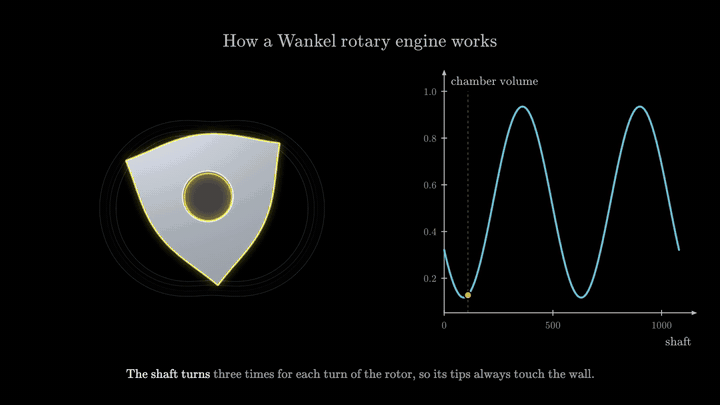
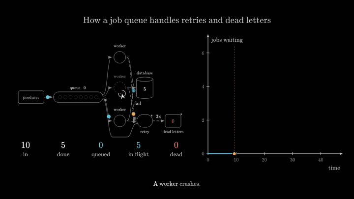
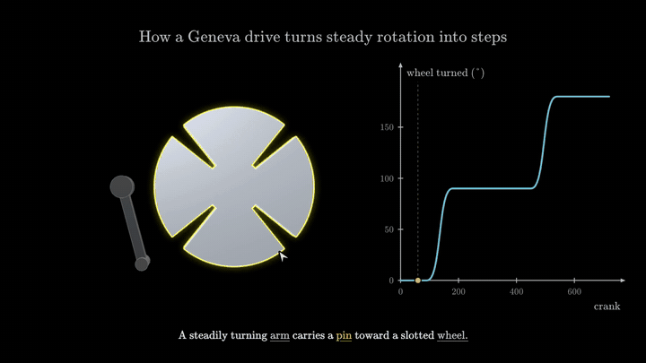
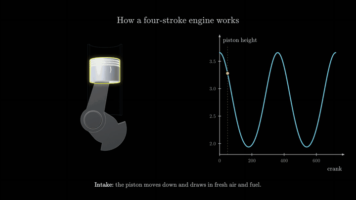
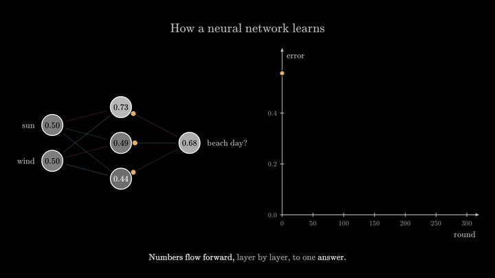
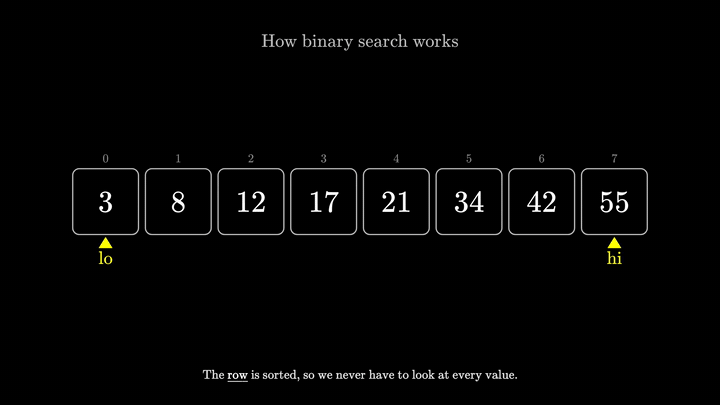

# Mimir

**Ask how something works. Get a narrated, animated, interactive explanation about thirteen seconds later.**

```sh
mimir new "how does a Wankel rotary engine work" --open
```

One call of a language model writes a short script. The engine lays it out, animates it, narrates it, checks it
and plays it. No positions, no sizes, no timings in the script, and no loop of render-look-fix behind it.

| | |
|---|---|
|  |  |
| `how does a Wankel rotary engine work`: one call, 14 s, 38 lines | `how does a job queue with retries and a dead letter queue work`: one call, 12 s, 16 lines |
|  |  |
| `how does a Geneva drive turn steady rotation into steps`: one call, 60 s, 63 lines | `how does a four-stroke engine work`: one call, 13 s, 55 lines |

Every clip above was written by a model in a single call and is in this repository as it came back:
[examples/generated/](examples/generated). Rebuild any of them with
`bin/mimir export examples/generated/<name>.scene.js --mp4 out.mp4`. The full videos are in [docs/media/](docs/media).

## What the model writes

This is the whole job-queue explainer. The queue really runs (a seeded simulation), the chart follows its real
depth, and the last step shows that the counts add up.

```js
import { explain, flow, chart } from 'mimir'
export default explain({
  title: 'How a job queue handles retries and dead letters',
  stage: {
    system: flow('producer -> queue[8] -> worker*3 -> database; worker -fail-> retry -> queue; retry -3x-> dead letters', {
      jobs: { count: 24, every: 1, service: [1.5, 2.2], seed: 5 },
    }),
    depth: chart({ x: 'time', y: 'jobs waiting', follow: 'system.queue' }),
  },
  story: [
    { say: 'The [producer](system.producer) adds jobs to a [queue](system.queue). [Workers](system.worker) take them one by one.', system: { until: 8 } },
    { say: 'A [worker](system.worker2) crashes. Its job goes to [retry](system.retry) and back into the queue.', system: { crash: 'worker2', until: 16 } },
    { say: 'A [poison job](system.deadLetters) fails everywhere. After three failures it is parked as a dead letter.', system: { poison: 1, until: 28 } },
    { say: 'Nothing is lost: every job is [done](system.done), waiting or [dead](system.dead).', system: { until: 'end', show: 'conservation' } },
  ],
})
```

A scene is `explain({ title, controls, stage, story })`: **blocks** on a stage, and a **story** of steps. Each step
says a sentence (links like `[queue](system.queue)` send a pointer to that part) and changes the state of a block.

| Block | For | Driven by |
|---|---|---|
| `cells` | algorithms over a row of values | a generator that really runs the algorithm |
| `flow` | systems: queues, workers, caches, retries | a seeded simulation, written as `a -> b[8] -> c*3` |
| `machine` | mechanisms in 3D | parts and joints; real kinematics over a control |
| `chart` | any quantity against another | a function, or a number another block produces |
| `layers` | neural networks | a network that is really trained while the scene is built |
| `sequence` | messages between parties | the list of messages |
| `formula` | typeset mathematics | terms highlighted and rewritten |
| `custom` | anything else | the full drawing API, fitted into its place for you |

Shapes come from maths, not from an asset library. A part that is not in the kit is its formula:

```js
const wall = (t) => [E * Math.cos(3 * t) + R * Math.cos(t), E * Math.sin(3 * t) + R * Math.sin(t)]   // an epitrochoid
housing: extrude(outset(curve(wall), 0.12), { depth: 0.4, holes: [curve(wall)] })                     // the chamber and its wall
```

The reference a model is given is one page: [docs/topics/quick.md](docs/topics/quick.md) (`mimir docs quick`).
Every script on that page is run by the test suite.

|  |  |
|---|---|
| [examples/quick-neural-network.scene.js](examples/quick-neural-network.scene.js), 27 lines | [examples/quick-binary-search.scene.js](examples/quick-binary-search.scene.js), 21 lines |

## What one explanation costs

Measured with `mimir bench` on six requests (binary search, a TCP handshake, a lever, bubble sort, a DNS lookup,
a pulley) and four harder ones, one run each:

| | model calls | tokens | seconds | cost | ready |
|---|---|---|---|---|---|
| an agent running a write-check-look-fix loop (where this project started) | 20 | 732k | 104 | $0.279 | 3 of 3 |
| `mimir new`, the adapter's default model | 1 | 8.3k | 13 | $0.014 | 6 of 6 |
| `mimir new --fast`, its cheapest model | 1 | 8.8k | 13 | $0.001 | 6 of 6 |
| `mimir new`: Geneva drive, four-stroke engine, job queue, gradient descent | 1 each | 8k to 13k | 12 to 60 | $0.006 to $0.063 | 4 of 4 |

Read these with their limits, which are spelled out in [docs/agents.md](docs/agents.md): "ready" means the
engine's own review of the result is clean, not that a person looked at it; a drawing can pass and still be plain;
and these are the last of four rounds on the same requests, with the engine fixed between rounds.

A change is one call too: `mimir new "make the rotor gold" --edit wankel-rotary-engine.scene.js`.

## Quickstart

You need [bun](https://bun.sh) 1.3.11 or later and a Chrome-family browser (Google Chrome, Chromium, Microsoft Edge
or Brave). ffmpeg is needed only for video export. `mimir new` also needs a model it can reach from a command line
(see below).

```sh
curl -fsSL https://bun.sh/install | bash          # install bun (other ways: https://bun.sh)
git clone https://github.com/CodeWithInferno/mimir.git && cd mimir
bun install

bin/mimir open examples/quick-job-queue.scene.js             # the player in your browser; edits to the file reload it
bin/mimir new "how does a lever work" --open                 # one call of a model, then it plays
bin/mimir export examples/quick-wankel.scene.js -o wankel.html    # one file that runs offline
bin/mimir export examples/quick-wankel.scene.js --mp4 wankel.mp4  # a video
```

`bin/mimir` is a POSIX shell launcher that runs the TypeScript sources with bun. There is no build step to run
first: the viewer bundle is built by the first command that needs it and rebuilt when the sources change. To have
`mimir` on your `PATH`: `ln -s "$PWD/bin/mimir" ~/.local/bin/mimir`.

If no browser is found, the command says where it looked; set `MIMIR_CHROME=/path/to/chrome`. More in
[docs/getting-started.md](docs/getting-started.md).

### Which model writes

The engine calls no model itself and holds no API key. `mimir new` starts a command line that answers in text:

- any command, through `MIMIR_WRITER_COMMAND` (the page and the request arrive on its stdin, the answer is read
  from its stdout): a local model behind `ollama run <model>` works as well as a hosted one;
- or an installed coding agent's command line, found automatically (`--agent` names one). One adapter has been run
  end to end by the maintainers; the others are marked untested in [docs/agents.md](docs/agents.md).

`mimir new --loop` hands the work to a headless coding agent that checks and looks at frames itself: several calls
instead of one, for when you want a second pair of eyes.

## How it works

- **A scene is a plain JavaScript module.** It runs once and records a timeline; the viewer then evaluates the
  state at any time. That is what makes scrubbing, deterministic frames, video export and `shot --at` possible.
- **The stage does the layout.** Blocks are arranged, fitted and centred; the caption strip is reserved; steps are
  paced from their narration.
- **Nothing is faked.** Numbers on screen come from a run, a simulation, kinematics or a formula inside the scene.
- **Mistakes do not throw.** An unknown name is one diagnostic with a did-you-mean and the rest still renders;
  natural slips of a first writing are given their obvious meaning instead of being reported.
- **The engine reviews the result.** `mimir review <scene>` prints the linter's findings (code, line, measured
  value, a literal fix), an account of every step, and composition findings. `mimir check` is the linter alone.
- **The player** has three modes: watch (it plays by itself), read (the whole explanation as a typeset column beside
  the stage) and explore (parameters, views, parts).

The full drawing API under `explain()` is there when you want it (`scene()`, 3D parts from a kit, 2D shapes,
verbs, plots, typeset maths, a pointer that flies to each part as it is named):
[examples/slider-crank.scene.js](examples/slider-crank.scene.js) is a good first read, `mimir docs` prints the
reference, and `mimir examples` lists every example.

## Examples

| Short scripts (`explain()`) | Lines |
|---|---|
| [quick-binary-search](examples/quick-binary-search.scene.js), [quick-bubble-sort](examples/quick-bubble-sort.scene.js), [quick-hash-table](examples/quick-hash-table.scene.js) | 19 to 39 |
| [quick-job-queue](examples/quick-job-queue.scene.js), [quick-request-flow](examples/quick-request-flow.scene.js), [quick-load-balancer](examples/quick-load-balancer.scene.js), [quick-handshake](examples/quick-handshake.scene.js) | 18 to 20 |
| [quick-gradient-descent](examples/quick-gradient-descent.scene.js), [quick-neural-network](examples/quick-neural-network.scene.js) | 27 to 30 |
| [quick-slider-crank](examples/quick-slider-crank.scene.js), [quick-rack-pinion](examples/quick-rack-pinion.scene.js), [quick-four-stroke](examples/quick-four-stroke.scene.js), [quick-thermostat](examples/quick-thermostat.scene.js) | 26 to 53 |
| [quick-geneva-drive](examples/quick-geneva-drive.scene.js), [quick-wankel](examples/quick-wankel.scene.js): nothing from the parts kit | 71 to 73 |

Written by a model in one call, unedited: [examples/generated/](examples/generated). Long-form scenes against the
full API (`neural-network`, `four-stroke-engine`, `job-queue`, `gradient-descent`, `pendulum` and more) are in
[examples/](examples); `bin/mimir examples` lists them with what each shows.

## What is not there

The dated list, with the command that proves each row, is [docs/STATUS.md](docs/STATUS.md). In short:

- **Looks vary.** Free drawings in `custom()` are the weakest; the cheapest model writes correct but plain scenes.
- **Requests of a new kind can still find a new mistake** and cost a second call.
- **Platforms**: developed and run on macOS with Google Chrome only. Linux has browser discovery and a CI job and
  has not been run by the authors. Windows is untested. Safari, Firefox and phones were never tried. Frame hashes
  are not promised to match across browsers, GPUs or operating systems.
- **Voice**: narration is shown as captions lit word by word; it is not spoken.
- **No package release**: clone the repository; nothing is published to a registry.

## Why JavaScript and not Rust

- The renderer has to run in a browser, where the output is watched and exported; a native core would still need a JS layer on top.
- Every WebAssembly option that was measured was heavier on the wire than its JavaScript alternative, and a scene should load only what it uses.
- Nothing the engine computes per frame is slow enough in JavaScript to need another language.
- Scenes are plain JS modules with no build step, which is the form both people and language models write most reliably.

## Documentation

- [docs/getting-started.md](docs/getting-started.md): install, first scene, troubleshooting
- [docs/topics/quick.md](docs/topics/quick.md): the one-page reference of `explain()`; [docs/QUICK.md](docs/QUICK.md): how the layer is built
- [docs/agents.md](docs/agents.md): `mimir new`, what it costs, adapters, the skill and the plugin
- [docs/cli.md](docs/cli.md): every command, flag, exit code and environment variable; [docs/CONFIG.md](docs/CONFIG.md): every default
- [docs/EXTENDING.md](docs/EXTENDING.md): adding kinds, verbs, rules and chunks to the engine
- [docs/DESIGN.md](docs/DESIGN.md): the design contract; [docs/STATUS.md](docs/STATUS.md): what works today
- [docs/OSS-HYGIENE.md](docs/OSS-HYGIENE.md): the rules every change keeps
- [CONTRIBUTING.md](CONTRIBUTING.md), [SECURITY.md](SECURITY.md), [CHANGELOG.md](CHANGELOG.md)

## Licence

MIT, see [LICENSE](LICENSE). Third-party code, fonts and ported algorithms are listed in
[THIRD_PARTY_NOTICES.md](THIRD_PARTY_NOTICES.md).
